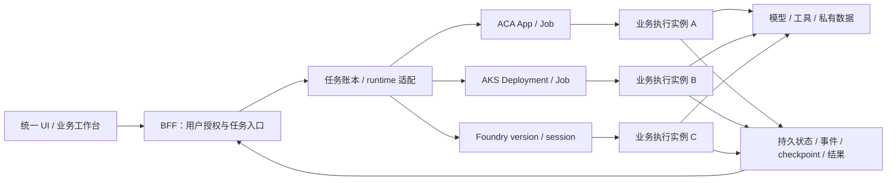
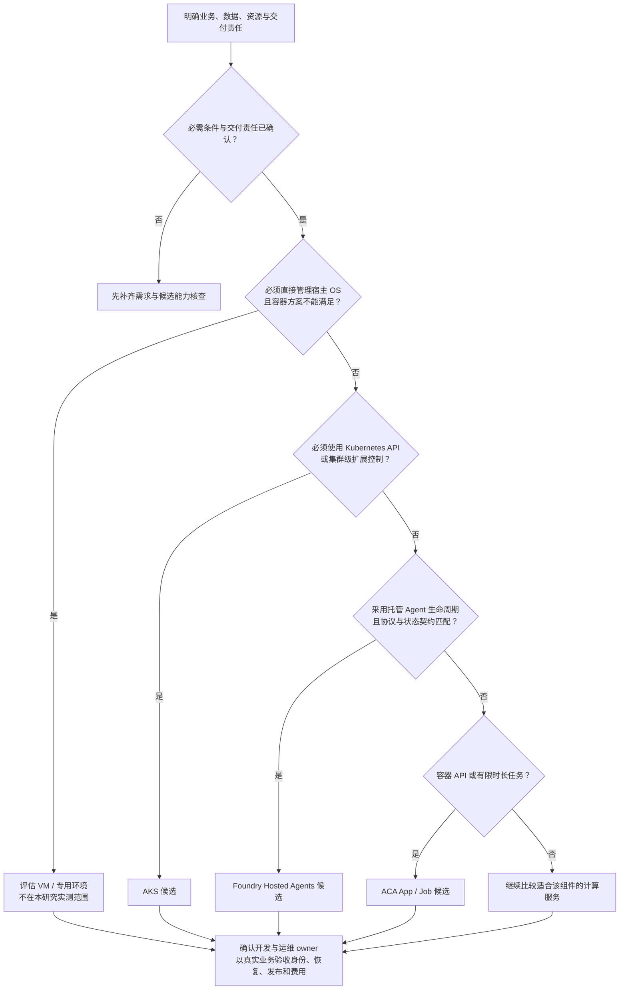

# Agent 运行架构对比：Foundry Hosted Agents、ACA 与 AKS

**面向 Azure 云架构师与互联网工程团队的研究报告。**

本研究将相同 Agent 业务分别运行在 Microsoft Foundry Hosted Agents、Azure Container Apps（ACA）和 Azure Kubernetes Service（AKS），比较业务接入、执行与恢复、网络与身份、发布和成本核算，帮助工程团队选择合适的运行架构。

**核心结论：三种运行方式都能承载本研究的业务；选型的主要差异是运行治理与团队责任，而不是所选 Agent 框架能否接入。**

实验事实截至 **2026-10-10**，本版更新于 **2026-10-12**。这是一份经过整理的结果报告，不是云资源实时状态页。

**阅读导航：**[实验目的](#1-实验目的) · [比较对象](#2-比较什么) · [实验架构](#3-实验架构) · [实验结果](#4-实验结果) · [优劣对比](#5-优劣对比与选型)

## 1. 实验目的

Agent 上线不只是让模型接口返回答案。业务还需要处理长任务、工具副作用、状态持久化、权限、版本变更和费用。本研究用真实业务与受控机制探针，回答三类客户问题：

| 客户问题 | 实验要提供的依据 |
|---|---|
| **现有业务能否迁移？** | 同一业务、Python/.NET 实现与工具会话在三端的实际执行结果 |
| **生产责任由谁承担？** | 区分平台生命周期、应用状态与授权、团队容量和发布治理 |
| **如何形成合理的选型与费用口径？** | 将运行机制、运维责任和实际用量结合，而不是只比较功能清单或 token 单价 |

研究对象是 **Agent 的运行架构与工程承载方式**，不是比较大模型能力、投资收益或检索算法优劣。

### 从客户场景转成工程问题

选型先明确 Agent 为谁完成什么任务，再确定运行要求。用户是企业员工还是外部客户，影响身份、数据权限和服务目标，但不能单独决定采用哪一种 runtime。

| 需求维度 | 需要明确的问题 | 本研究可提供的工程依据 |
|---|---|---|
| **交互与任务** | 是在线查询、有界后台任务，还是跨多个步骤的协作？ | T/R/S 业务接入、任务回执与事件关联 |
| **状态与恢复** | 保存会话、文件还是执行进度？中断后能否重复工具副作用？ | Checkpoint、持久状态、断线与协调服务重启对照 |
| **连接与授权** | 访问哪些私有系统？实际执行身份应允许或拒绝哪些资源？ | 共同私有 API、Vault/Storage 的数据面正反对照 |
| **控制与交付** | 是否需要 Kubernetes API 或宿主 OS 控制？谁负责开发、发布和运维？ | 三端责任边界与真实升级/回滚结果 |
| **治理与成本** | 数据区域、隔离、审计和费用归集要求是什么？ | 应用权限、故障关联及分层费用组件 |

**实验要支持的是“场景 → 技术要求 → 责任分配 → 业务验收”的决策过程，而不是给 Azure 服务贴一个固定的好坏标签。**场景可以采用单 Agent、多个 Agent 或普通模型调用；按业务需求使用足够简单的方案。

## 2. 比较什么

### 三种运行方式

| Runtime | 本研究采用的运行单元 | 比较重点 |
|---|---|---|
| **ACA** | Container App、Job、revision | 托管容器如何承载在线服务、后台任务与版本切换 |
| **AKS** | Deployment、Service、Job、Pod | Kubernetes 的调度、资源、网络与集群治理责任 |
| **Foundry Hosted Agents** | Agent、immutable version、endpoint、session | 托管 Agent 的接入协议、身份、版本与会话生命周期 |

Foundry 在这里指可运行自有容器代码的 **Hosted Agents**，不是只通过提示词配置的 Agent，也不是单独的模型部署服务。AKS 使用常规集群管理方式，不将其运维责任直接套用于 AKS Automatic。

### 三类工作负载

| 代号 | 工作负载 | 输入与产出 | 代表的工程场景 |
|---|---|---|---|
| **T** | Trading 多 Agent 分析 | 股票与日期，经分析、讨论和风险评估生成报告及导出 | 长流程编排、工具调用、事件、状态与报告交付 |
| **R** | 多模态商品 RAG | 固定 200 个商品，使用 CLIP/Chroma 检索并生成回答 | 检索服务、模型与索引加载、文本/图片输入和在线响应 |
| **S** | 工具会话与确定性机制探针 | 两轮工具会话，以及固定恢复、权限、超时和计算任务 | 框架兼容、执行语义与工程边界 |

编程模型采用五种实现：**Python 自定义循环、Python LangGraph、Python Microsoft Agent Framework、C# Microsoft Agent Framework、C# Semantic Kernel**。每种实现都验证第一轮工具执行和第二轮历史消费。

### 比较原则

保持业务逻辑、输入输出契约和验收口径一致，并为每批结果绑定源码、镜像或版本与原生任务。真实业务、确定性机制探针和历史回放分开统计；模型、网关、存储等公共依赖单独归因。

不同批次的资源、缓存和区域条件不强行合并。因此，本研究可以判断接入可行性与工程责任，但不把现有小样本加工成统一性能排名。详细口径见[实验方法](docs/methodology.md)。

## 3. 实验架构

**同一套业务与交互契约，通过适配层分别进入三种 runtime。**

三个业务实例表示相同逻辑分别在三端执行，不是通过不同入口访问同一个中央 worker。网关部署位置不等于业务执行位置；执行验收关联原生任务、镜像或版本与业务回执。

| 层 | 职责 |
|---|---|
| **交互与应用层** | 用户授权、输入校验、任务账本、工具调用、幂等、状态与结果交付 |
| **运行平台层** | 实际运行进程，提供原生调度、版本、身份和生命周期机制 |
| **公共依赖与证据层** | 模型、私有存储、检索索引，以及用量、事件与原生执行证据 |

架构上的关键是区分**原生 session、业务 workspace、任务记录、工作文件和 checkpoint**。它们承担不同职责，不能因为 session ID 相同就推导全部业务状态已恢复。详细设计见[参考架构与责任边界](docs/reference-architecture.md)。

## 4. 实验结果

### 4.1 真实业务：9 个组合均取得成功回执

| 业务 | ACA | AKS | Foundry | 实际验收内容 |
|---|---|---|---|---|
| **Trading** | 已验证 | 已验证 | 已验证 | 原业务流程、真实行情、17 次模型请求、报告与结果导出 |
| **商品 RAG** | 已验证 | 已验证 | 已验证 | 真实商品索引、文本查询、1 次真实模型回答 |
| **工具会话** | 已验证 | 已验证 | 已验证 | LangGraph、3 次真实模型请求、1 次工具执行、两轮历史消费 |

这证明三端都能实际承载本研究业务，而不是仅完成镜像启动或接口健康检查。**9 个组合覆盖不等于 100% 请求成功率：**该批次保留 11 次原始尝试，其中 9 次成功、2 次 Foundry 未确认；后续修正使用新任务，原记录不被覆盖。

RAG 的这一批真实模型回答覆盖文本查询；图片与混合输入的检索、回放及早期真实生成在其他批次单独记录。

### 4.2 编程模型：15 格真实会话验收

五种 Python/.NET 实现分别在三端完成一组真实两轮会话，共 **15 格**。第一轮执行一次商品工具，第二轮消费工具结果与历史。

**结论：所选框架的业务接入可行。**兼容性应作为准入条件，而不是取代状态、网络、身份和运维责任的完整判断。

### 4.3 关键工程机制

| 方向 | 三端已验证结果 | 对工程设计的意义 |
|---|---|---|
| **任务与恢复** | 完成任务回执与去重读回；worker 终止后的 checkpoint 对照中，固定模型操作从 27 次变为 23 次，两组 15 个副作用均各执行一次 | 任务和副作用需要持久账本，恢复从明确步骤开始 |
| **状态与权限** | 十次团队状态更新、跨工作区与会话拒绝、客户端断开和协调服务重启；连续 **1,800.015 秒**无请求后应用状态保留 | 状态依靠应用持久存储与权限契约，而不是进程内存 |
| **应用隔离** | 两个工作区分别完成私有输入、257 项计算与 **512×320 PNG**；越权访问被拒绝，子进程不接收云凭据 | 将权限与数据绑定落实到实际执行路径 |
| **私网与身份** | 共同私有 API 的 DNS/TLS 与拒绝端口对照，以及共同 Vault/Storage 的工作负载身份允许/拒绝对照 | 企业接入验收必须覆盖真实数据面请求 |
| **故障定位** | 真实工具子进程超时并退出，关联任务、版本、原生 job 和错误事件 | 用同一关联链定位错误，而不是分散查日志 |
| **升级回滚** | 每端完成 V1 在途任务、2 个 V2 业务任务与 2 个回滚后 V1 业务任务；Foundry 旧 session 保持版本和回执绑定 | 发布应验收在途任务、真实业务和回滚结果 |
| **费用组件** | 分层记录模型用量估算、资源账单与 **1,945.125 秒**资源空闲观察 | 模型、平台计算、共享层和工程成本分别核算 |

Checkpoint、隔离和超时属于确定性机制探针，不产生付费模型请求；其操作计数不等于 token 节省率。状态保留证明应用持久状态，应用权限验证也不等于强安全沙箱认证。故障探针捕获预期错误时，注入任务本身仍记录为失败。

### 4.4 结果如何追溯

历史对照保留原分母：早期框架真实会话完整验收 **14/15**；业务回放 **279 次中 253 成功、22 失败、4 未确认**；早期真模型业务 **18 次中 16 成功、2 失败**，其 Trading 行情为固定输入。这些批次没有与较新的真实行情业务合并计算指标。

完整结果见[已验证结果](docs/validated-findings.md)，费用口径见[成本与运维结论](docs/cost-and-operations.md)。公开数字对应[结构化证据摘要](evidence/verified-findings.json)与[来源哈希](evidence/sources.json)。

## 5. 优劣对比与选型

**三种方式的主要差异，是控制能力与管理责任的分配。**

| Runtime | 优势 | 代价与责任边界 | 更匹配的场景 |
|---|---|---|---|
| **ACA** | App/Job 与已有容器 API、后台任务契约吻合；可采用托管容器与 revision 管理，减少自管集群治理面 | 应用仍负责任务账本、checkpoint 和幂等；团队需要配置容量、扩缩容和发布策略 | 已有容器化服务，没有必须自管 Kubernetes 的需求 |
| **AKS** | 原生 Job/Pod/节点可以直接关联；适合细粒度调度、节点池、网络策略和工作负载组合 | 常规集群的升级、节点容量、调度与策略治理面更广；应用运行语义仍由团队实现 | 已有 Kubernetes 平台团队，确实需要这些控制能力 |
| **Foundry Hosted Agents** | Agent endpoint、identity、version 与 session 生命周期符合 Agent 产品对象；可采用托管平台机制 | 需要理解所选协议下的平台行为；业务状态、工具授权、幂等和副作用恢复仍要定义应用契约 | 产品以托管 Agent 服务和会话生命周期为中心 |

**选型建议：**普通容器化 Agent 服务可优先评估 ACA；已具备 Kubernetes 治理能力且需要细粒度控制的团队可优先评估 AKS；围绕托管 Agent 生命周期构建产品可优先评估 Foundry。

这不是“谁总体最好”的排序，也不以 token 均价推导平台总成本。先确定所需能力与团队责任，再用目标业务做上线验收。详细判断及官方产品依据见[架构选型建议](docs/architecture-decision.md)。

### 5.1 技术决策树（Decision Tree）

对每个执行组件分别选择运行方式；网关、Agent worker、检索和模型服务不必全部使用同一种计算服务。

这是本报告依据公开 Azure 架构资料整理的**技术筛选路径**，不是产品限制或生产认证。托管基础设施不等于无需开发；ACA 不开放底层 Kubernetes API，而 Foundry 的 Agent 代码、工具权限与业务副作用仍需明确实现。具体前置条件和验证清单见[完整选型指南](docs/architecture-decision.md)。

### 5.2 按实际需求选择组合（Use Cases）

| 场景 | 优先评估的组合 | 最关键的运行要求 | 与本研究的关联 |
|---|---|---|---|
| **在线检索与服务助手** | ACA 承载已有接口；需要托管 Agent 会话时评估 Foundry | 查询权限、响应、结果来源和下游工具授权 | R 的真实检索/文本回答；P6/P7 |
| **长流程研究与报告** | 按控制需求选择 ACA、AKS 或 Foundry，配合任务账本与 checkpoint | 在途版本绑定、状态恢复、副作用幂等与报告交付 | T；P3/P9 |
| **受控工具与开发辅助** | 独立执行边界加所选 runtime；需要 Kubernetes 控制时评估 AKS | 工具授权、凭据隔离、资源限制和异常退出 | S；P4/P8，当前为固定工具探针 |
| **多业务 Agent 托管** | 需要平台 Agent 对象时评估 Foundry；已有容器平台时复用 ACA/AKS | 版本、身份、配额、业务边界和发布治理 | P1/P7/P9 |
| **事件驱动与有限时长处理** | ACA App/Job 或其他匹配的计算服务 | 持续消费与单次执行分开，确认重试和去重语义 | 平台设计建议；不作为新增执行验收 |
| **多组织或敏感数据应用** | 在满足数据、身份、区域和隔离要求的候选中选择 | 租户范围、审计、私网、数据生命周期与职责 | P4/P6/P7 提供部分机制证据，不构成完整合规认证 |

这些是可重叠的需求画像，不是已全部上线的行业方案。同一业务可以既是多租户服务，又包含长任务和工具执行。详细场景、必要配套及验收问题见[场景与服务组合指南](docs/use-cases.md)。

## 阅读入口

| 阅读目的 | 文档 |
|---|---|
| 快速确定运行方式 | [架构选型建议](docs/architecture-decision.md) |
| 将客户场景转换成运行要求 | [场景与服务组合](docs/use-cases.md) |
| 查看实际验证结果 | [已验证结果](docs/validated-findings.md) |
| 设计网关、状态、身份与发布链路 | [参考架构与责任边界](docs/reference-architecture.md) |
| 制定费用核算和运维规则 | [成本与运维结论](docs/cost-and-operations.md) |
| 理解实验批次和统计口径 | [实验方法](docs/methodology.md) |
| 核查数字来源 | [证据索引](docs/evidence-index.md) |

## 适用范围与发布边界

本报告用于架构选型和工程设计，不提供生产 SLA、性能冠军、完整 TCO 排名或强安全沙箱认证。真实业务验证、确定性机制探针和历史回放分开统计；较新的成功不覆盖原始失败或未确认记录。

本公共仓库只包含自编研究报告与经过字段筛选的证据摘要。实现代码、部署配置、原始日志、私有输入、凭据和原仓库历史均不在此分发。公开摘要提供来源文件哈希和校核口径；不等同于向外部读者开放了完整实验复现环境。
