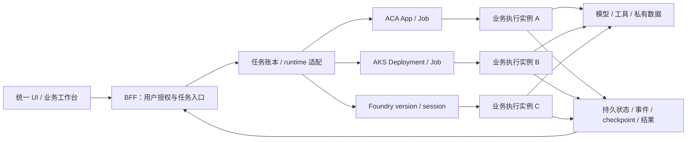
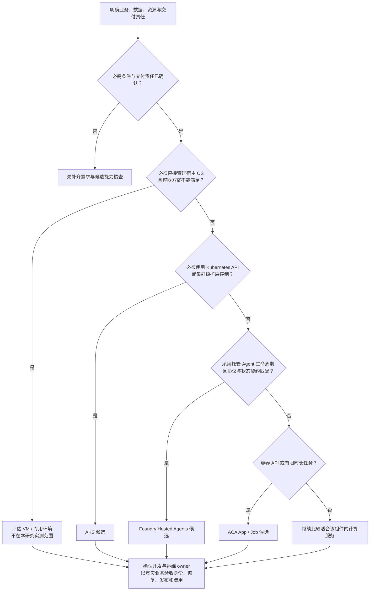

# Agent 运行架构对比：Foundry Hosted Agents、ACA 与 AKS

**面向 Azure 云架构师与互联网工程团队的研究报告。**

本研究将相同 Agent 业务分别运行在 Microsoft Foundry Hosted Agents、Azure Container Apps（ACA）和 Azure Kubernetes Service（AKS），比较业务接入、执行与恢复、网络与身份、发布和成本核算，帮助工程团队选择合适的运行架构。

**核心结论：三种运行方式都能承载本研究的业务；选型的主要差异是运行治理与团队责任，而不是所选 Agent 框架能否接入。**

实验事实截至 **2026-10-10**，本版更新于 **2026-10-12**。这是一份经过整理的结果报告，不是云资源实时状态页。

**阅读导航：**[实验目的](#1-实验目的) · [比较对象](#2-比较什么) · [实验架构](#3-实验架构) · [实验结果](#4-实验结果) · [优劣对比](#5-优劣对比与选型)

## 1. 实验目的

Agent 上线不只是让模型接口返回答案。业务还需要处理长任务、工具副作用、状态持久化、权限、版本变更和费用。本研究用真实业务与受控机制探针，回答三类客户问题：

| 客户问题 | 实验要提供的依据 |
|---|---|
| **现有业务能否迁移？** | 同一业务、Python/.NET 实现与工具会话在三端的实际执行结果 |
| **生产责任由谁承担？** | 区分平台生命周期、应用状态与授权、团队容量和发布治理 |
| **如何形成合理的选型与费用口径？** | 将运行机制、运维责任和实际用量结合，而不是只比较功能清单或 token 单价 |

研究对象是 **Agent 的运行架构与工程承载方式**，不是比较大模型能力、投资收益或检索算法优劣。

### 从客户场景转成工程问题

选型先明确 Agent 为谁完成什么任务，再确定运行要求。用户是企业员工还是外部客户，影响身份、数据权限和服务目标，但不能单独决定采用哪一种 runtime。

| 需求维度 | 需要明确的问题 | 本研究可提供的工程依据 |
|---|---|---|
| **交互与任务** | 是在线查询、有界后台任务，还是跨多个步骤的协作？ | T/R/S 业务接入、任务回执与事件关联 |
| **状态与恢复** | 保存会话、文件还是执行进度？中断后能否重复工具副作用？ | Checkpoint、持久状态、断线与协调服务重启对照 |
| **连接与授权** | 访问哪些私有系统？实际执行身份应允许或拒绝哪些资源？ | 共同私有 API、Vault/Storage 的数据面正反对照 |
| **控制与交付** | 是否需要 Kubernetes API 或宿主 OS 控制？谁负责开发、发布和运维？ | 三端责任边界与真实升级/回滚结果 |
| **治理与成本** | 数据区域、隔离、审计和费用归集要求是什么？ | 应用权限、故障关联及分层费用组件 |

**实验要支持的是“场景 → 技术要求 → 责任分配 → 业务验收”的决策过程，而不是给 Azure 服务贴一个固定的好坏标签。**场景可以采用单 Agent、多个 Agent 或普通模型调用；按业务需求使用足够简单的方案。

## 2. 比较什么

### 三种运行方式

| Runtime | 本研究采用的运行单元 | 比较重点 |
|---|---|---|
| **ACA** | Container App、Job、revision | 托管容器如何承载在线服务、后台任务与版本切换 |
| **AKS** | Deployment、Service、Job、Pod | Kubernetes 的调度、资源、网络与集群治理责任 |
| **Foundry Hosted Agents** | Agent、immutable version、endpoint、session | 托管 Agent 的接入协议、身份、版本与会话生命周期 |

Foundry 在这里指可运行自有容器代码的 **Hosted Agents**，不是只通过提示词配置的 Agent，也不是单独的模型部署服务。AKS 使用常规集群管理方式，不将其运维责任直接套用于 AKS Automatic。

### 三类工作负载

| 代号 | 工作负载 | 输入与产出 | 代表的工程场景 |
|---|---|---|---|
| **T** | Trading 多 Agent 分析 | 股票与日期，经分析、讨论和风险评估生成报告及导出 | 长流程编排、工具调用、事件、状态与报告交付 |
| **R** | 多模态商品 RAG | 固定 200 个商品，使用 CLIP/Chroma 检索并生成回答 | 检索服务、模型与索引加载、文本/图片输入和在线响应 |
| **S** | 工具会话与确定性机制探针 | 两轮工具会话，以及固定恢复、权限、超时和计算任务 | 框架兼容、执行语义与工程边界 |

编程模型采用五种实现：**Python 自定义循环、Python LangGraph、Python Microsoft Agent Framework、C# Microsoft Agent Framework、C# Semantic Kernel**。每种实现都验证第一轮工具执行和第二轮历史消费。

### 比较原则

保持业务逻辑、输入输出契约和验收口径一致，并为每批结果绑定源码、镜像或版本与原生任务。真实业务、确定性机制探针和历史回放分开统计；模型、网关、存储等公共依赖单独归因。

不同批次的资源、缓存和区域条件不强行合并。因此，本研究可以判断接入可行性与工程责任，但不把现有小样本加工成统一性能排名。详细口径见[实验方法](docs/methodology.md)。

## 3. 实验架构

**同一套业务与交互契约，通过适配层分别进入三种 runtime。**

三个业务实例表示相同逻辑分别在三端执行，不是通过不同入口访问同一个中央 worker。网关部署位置不等于业务执行位置；执行验收关联原生任务、镜像或版本与业务回执。

| 层 | 职责 |
|---|---|
| **交互与应用层** | 用户授权、输入校验、任务账本、工具调用、幂等、状态与结果交付 |
| **运行平台层** | 实际运行进程，提供原生调度、版本、身份和生命周期机制 |
| **公共依赖与证据层** | 模型、私有存储、检索索引，以及用量、事件与原生执行证据 |

架构上的关键是区分**原生 session、业务 workspace、任务记录、工作文件和 checkpoint**。它们承担不同职责，不能因为 session ID 相同就推导全部业务状态已恢复。详细设计见[参考架构与责任边界](docs/reference-architecture.md)。

**实验如何执行**

1. **固定业务与验收契约。**使用相同业务逻辑、明确输入和预期输出，记录源码、镜像或版本；资源、区域和缓存条件按批次保留，不将不同条件强行合并。
2. **在三端分别实际执行。**从统一入口提交任务，绑定 runtime、版本与原生执行对象；核对事件、真实模型/工具调用和最终业务结果，而不以接口健康或资源创建成功代替验收。
3. **设置对照并保留原记录。**正常路径与允许/拒绝、开启/关闭 checkpoint、故障注入和升级/回滚分别对照；失败与未确认保留，未确认先按原任务 ID 协调读回，不盲目重新派发。

**十个维度的具体方法与关键工程机制**

| 维度 | 具体操作与对照 | 验收方法与关键机制 |
|---|---|---|
| **P1 编程模型** | 五种 Python/.NET 实现分别在三端运行一组真实两轮会话；第一轮调用商品工具，第二轮继续消费历史 | 检查真实模型请求、工具执行次数与第二轮内容，区分框架接入失败与共享模型配额拒绝 |
| **P2 执行模型** | 提交绑定 runtime/版本的业务任务，关联原生执行对象、事件与结果，并按原任务读回回执 | 使用持久任务账本核对接受、执行和结果归属；本批仅提供回执范围证据，不据此认定完整流式、并发与取消语义 |
| **P3 状态与恢复** | 在相同步骤终止 worker，对照 checkpoint 关闭/开启后的恢复；另做十次团队状态更新、过期写入和越权对照、客户端断开、协调服务重启及无请求状态保留 | 比较固定模型操作数与副作用次数；核对持久状态、权限、原任务回执和窗口内调用记录。Checkpoint 与幂等共同控制恢复，客户端连接不作为任务生命周期 |
| **P4 应用隔离** | 在两个 workspace 分别加载限定范围的私有输入，由不接收云凭据的子进程完成固定计算和 PNG 产出；检查输入绑定、退出及本地兄弟目录标记访问 | 核对 257 项计算的平方和、独立解码图片和执行凭据边界；结合 P3 的跨 workspace 拒绝，区分应用 ACL 与 OS/容器强隔离 |
| **P5 业务运行** | 分别提交 T 的真实行情分析、R 的固定 200 商品索引文本查询、S 的 LangGraph 工具会话 | 核对模型请求、工具/检索结果、报告与导出。此批确认真实业务运行，未重做冷/热启动、吞吐或资源效率性能矩阵 |
| **P6 私网连接** | 从三端执行环境访问共同私有 API，检查 DNS、TLS 主机名与允许目标，再尝试拒绝端口 | 以实际解析、HTTP 响应与连接拒绝验收，不以私网资源配置存在代替数据面验证 |
| **P7 身份授权** | 使用三端实际工作负载身份访问共同 Vault/Storage，对允许与拒绝目标分别发起数据面请求 | 核对最小权限是否落实到实际执行身份；用户、网关与工作负载身份分开，不把角色分配成功当作授权验收 |
| **P8 故障定位** | 从外层工作台任务表单提交受控工具超时任务，加载原 T 实现并触发工具子进程超时、退出 | 将任务、runtime、版本、原生执行对象、工具事件与错误码关联；确认注入任务失败且子进程退出，不将探针验收成功改写为业务成功 |
| **P9 升级回滚** | 先提交 V1 在途任务，切换 V2 后运行 Trading/RAG，再回滚 V1 并重新运行两类业务；Foundry 同时核对旧原生 session | 以真实结果、报告/导出与版本绑定验收；新任务采用新版本，在途任务和旧 session 不随路由切换改绑 |
| **P10 费用核算** | 按业务尝试记录模型请求与 token，用成功任务计算模型均价估算；结合业务子进程采样、资源账单及独立无业务窗口观察 | 分开处理模型估算、平台计算、共享层、失败与工程投入；资源观察不直接转换为计费时长或单任务平台账单 |

**统计口径：**真实模型业务、确定性机制探针与历史回放分别统计。Checkpoint、固定计算/隔离及受控超时不产生付费模型请求；其模型操作数不是 token 节省率。P3 的无请求状态保留与 P10 的资源空闲观察是两个独立窗口。详细规则见[实验方法](docs/methodology.md)。

## 4. 实验结果

### 4.1 具体结果

展开各维度可查看 **ACA、AKS、Foundry Hosted Agents** 的具体观测与结论边界。以下以较新的补充证据为主；“已验证”只指列出的业务或机制，不表示完整 P1–P10 生产验收全部通过。

<strong>P1 编程模型：五种实现均完成真实两轮会话</strong>

| Runtime | 实现覆盖 | 每种实现的实际调用 | 历史消费 |
|---|---|---|---|
| **ACA** | 5/5；各一组两轮会话 | 3 次真实模型请求、1 次工具执行 | 第二轮均消费工具结果与历史 |
| **AKS** | 5/5；各一组两轮会话 | 3 次真实模型请求、1 次工具执行 | 第二轮均消费工具结果与历史 |
| **Foundry** | 5/5；各一组两轮会话 | 3 次真实模型请求、1 次工具执行 | 第二轮均消费工具结果与历史 |

五种实现为 Python 自定义循环、LangGraph、Python MAF、C# MAF、C# Semantic Kernel，共 **15 格**。结论是这些实现的接入可行，不是所有框架或任意配置均已认证。

<strong>P2 执行模型：任务回执可追溯，证据范围为回执核对</strong>

| Runtime | 关联的运行对象 | 当前结果 |
|---|---|---|
| **ACA** | App/Job、revision 与业务任务 | 已核对任务与结果回执；未形成完整执行语义评分 |
| **AKS** | Deployment/Job、Pod 与业务任务 | 已核对任务与结果回执；未形成完整执行语义评分 |
| **Foundry** | Agent version/session 与业务任务 | 已核对任务与结果回执；未形成完整执行语义评分 |

任务、事件、版本和结果使用同一账本关联，读回已有任务不等于提交新任务。公开证据将此维度标为 **回执范围**；不能据此宣称流式、并发、取消或完整调度矩阵均已验收。

<strong>P3 状态与恢复：checkpoint、权限、断线与持久状态对照已验证</strong>

| Runtime | Checkpoint 关闭 → 开启 | 状态与权限 | 断线、重启与无请求保留 |
|---|---|---|---|
| **ACA** | 固定模型操作 27 → 23；两组 15 个副作用均各一次 | 10 次团队状态更新；过期写入、私有会话与跨 workspace 访问拒绝 | 断开 10 秒后原任务完成；协调服务重启后状态与已完成回执保留；无请求 1,800.015 秒状态保留 |
| **AKS** | 固定模型操作 27 → 23；两组 15 个副作用均各一次 | 10 次团队状态更新；过期写入、私有会话与跨 workspace 访问拒绝 | 断开 10 秒后原任务完成；协调服务重启后状态与已完成回执保留；无请求 1,800.015 秒状态保留 |
| **Foundry** | 固定模型操作 27 → 23；两组 15 个副作用均各一次 | 10 次团队状态更新；过期写入、私有会话与跨 workspace 访问拒绝 | 断开 10 秒后原任务完成；协调服务重启后状态与已完成回执保留；无请求 1,800.015 秒状态保留 |

状态保留窗口内三端原生调用均为 **0**。协调服务重启后，被中断任务保持**未确认**，不自动重新派发；不是所有业务自动恢复成功。Checkpoint 使用确定性机制探针，真实 provider 请求为零；这里证明的是应用持久状态，不是容器 RAM、平台 HOME 或物理实例保留。

<strong>P4 应用隔离：输入绑定、固定产出与凭据边界已验证，非强沙箱认证</strong>

| Runtime | 两个 workspace 的实际产出 | 输入与凭据边界 | 本地访问对照 |
|---|---|---|---|
| **ACA** | 每个 257 项计算，平方和 1,414,528；512×320 PNG 独立解码 | 私有输入范围绑定；子进程无云凭据，退出已确认 | 兄弟目录本地标记可读 |
| **AKS** | 每个 257 项计算，平方和 1,414,528；512×320 PNG 独立解码 | 私有输入范围绑定；子进程无云凭据，退出已确认 | 兄弟目录本地标记可读 |
| **Foundry** | 每个 257 项计算，平方和 1,414,528；512×320 PNG 独立解码 | 私有输入范围绑定；子进程无云凭据，退出已确认 | 兄弟目录本地标记可读 |

固定计算探针的真实 provider 请求为 **0**。P3 的跨 workspace 应用访问拒绝与此处的本地目录对照是不同边界；本地标记可读说明不能把应用 ACL 当作 OS/容器强隔离。三端证据均明确 **未证明强安全沙箱**，不认证任意代码执行。

<strong>P5 业务运行：T/R/S 九个组合均取得成功回执，未重做性能矩阵</strong>

| Runtime | T：Trading | R：商品 RAG | S：工具会话 |
|---|---|---|---|
| **ACA** | 真实行情与原业务；17 次模型请求；报告及导出 | 真实商品索引文本查询；1 次模型回答 | LangGraph；3 次模型请求、1 次工具执行、两轮历史 |
| **AKS** | 真实行情与原业务；17 次模型请求；报告及导出 | 真实商品索引文本查询；1 次模型回答 | LangGraph；3 次模型请求、1 次工具执行、两轮历史 |
| **Foundry** | 真实行情与原业务；17 次模型请求；报告及导出 | 真实商品索引文本查询；1 次模型回答 | LangGraph；3 次模型请求、1 次工具执行、两轮历史 |

这是 **9 个业务组合均有成功回执**，不是 100% 请求成功率：该批保留 **11 次原始尝试，9 次成功、2 次 Foundry 未确认**；后续修正使用新任务，原记录不覆盖。

RAG 固定 200 个商品，本批付费回答为文本查询；图片/混合输入的检索、回放与早期真实生成分批记录。此维度当前为**业务运行范围**，未重复完整性能矩阵，不给出冷启动、稳定 P95、吞吐或资源效率排名。

<strong>P6 私网连接：共同私有 API 的允许与拒绝对照已验证</strong>

| Runtime | 私有 API 访问 | TLS 校验 | 拒绝端口对照 |
|---|---|---|---|
| **ACA** | 实际 DNS/连接核对；HTTP 200 | 主机名校验通过 | 连接被拒绝 |
| **AKS** | 实际 DNS/连接核对；HTTP 200 | 主机名校验通过 | 连接被拒绝 |
| **Foundry** | 实际 DNS/连接核对；HTTP 200 | 主机名校验通过 | 连接被拒绝 |

三端模型调用均为 **0**。结论限定于本研究的共同私有 API 与网络配置，不是任意客户拓扑或所有出网路径均已认证。

<strong>P7 身份授权：共同 Vault/Storage 的实际允许与拒绝对照已验证</strong>

| Runtime | 验收身份 | 数据面结果 |
|---|---|---|
| **ACA** | 实际工作负载身份 | 共同 Vault/Storage 允许与拒绝对照均通过 |
| **AKS** | 实际工作负载身份 | 共同 Vault/Storage 允许与拒绝对照均通过 |
| **Foundry** | Agent 工作负载身份 | 共同 Vault/Storage 允许与拒绝对照均通过 |

三端模型调用均为 **0**。这证明所配置身份与目标资源权限落实到实际请求，不代表所有 Azure 服务授权、业务租户隔离或完整合规评估。

<strong>P8 故障定位：工具超时与退出可关联，注入任务保留失败</strong>

| Runtime | 注入任务结果 | 错误与退出 | 故障关联 |
|---|---|---|---|
| **ACA** | failed | `controlled_tool_timeout`；worker 退出已确认 | 任务、版本、原生执行对象与工具事件可关联 |
| **AKS** | failed | `controlled_tool_timeout`；worker 退出已确认 | 任务、版本、原生执行对象与工具事件可关联 |
| **Foundry** | failed | `controlled_tool_timeout`；worker 退出已确认 | 任务、版本、原生执行对象与工具事件可关联 |

三端均加载原 T 实现，从**外层工作台任务表单**注入受控工具超时，模型调用为 **0**；不是内层业务表单完整故障矩阵，也不是 T 的正常模型流程失败率统计。已验证的是错误捕获、退出与关联链，注入业务本身没有改记为成功。

<strong>P9 升级回滚：真实业务与在途版本绑定已验证</strong>

| Runtime | 升级到 V2 | 回滚到 V1 | 在途与旧对象 |
|---|---|---|---|
| **ACA** | 2 个业务任务：Trading、RAG | 2 个业务任务：Trading、RAG | 原 V1 在途任务绑定保留 |
| **AKS** | 2 个业务任务：Trading、RAG | 2 个业务任务：Trading、RAG | 原 V1 在途任务绑定保留 |
| **Foundry** | 2 个业务任务：Trading、RAG | 2 个业务任务：Trading、RAG | 原 V1 在途任务及旧原生 session 的版本、回执绑定保留 |

三端验收通过，该批结束时 release 均为 **V1**；真实业务结果与导出已核对，原失败仍保留。结论是本次发布路径可用，不自动扩展为所有变更零停机或生产发布 SLA。

<strong>P10 费用核算：模型估算与资源观察已记录，完整 TCO 未完成</strong>

以下是**发布验收批次**的成功任务模型用量均价估算，单位 **USD**；不是 P5 九个业务组合的原始尝试分母。

| Runtime | Trading 成功/尝试 | Trading 模型均价估算 | RAG 成功/尝试 | RAG 模型均价估算 | 独立资源空闲观察 |
|---|---|---|---|---|---|
| **ACA** | 3/4 | 0.514308 | 4/4 | 0.003868 | 1,945.125 秒 |
| **AKS** | 4/6 | 0.533487 | 3/3 | 0.003995 | 1,945.125 秒 |
| **Foundry** | 4/4 | 0.560785 | 3/3 | 0.003981 | 1,945.125 秒 |

该批合计 **24 次尝试、21 次成功、3 次失败**；均价只统计成功任务，失败不从原分母删除。RAG 按六位小数展示。已取得分层用量、业务子进程采样与资源账单组件，但**单任务基础设施账单、精确空闲窗口账单、共享层请求分摊及工程工时未完成**。

因此这些值不是单任务平台费用，也不是 TCO；不能按模型均价宣布 runtime 总成本赢家。P10 的资源窗口与 P3 的状态保留窗口分开，详细口径见[成本与运维结论](docs/cost-and-operations.md)。

### 4.2 结果概览

| 比较项 | 当前结论 | 选型时如何使用 |
|---|---|---|
| **真实业务运行** | T/R/S × 三端共 9 个组合均有成功回执；原始 11 次尝试中 9 成功、2 未确认 | 三端均可承载本研究业务；覆盖结论不是生产成功率 |
| **编程模型接入** | 五种实现 × 三端共 15 格真实两轮会话验收 | 这些实现接入可行，框架不构成本研究的主要选型分界 |
| **执行与恢复** | P2 为回执范围；P3 完成 checkpoint、权限、断线、重启及持久状态对照 | 使用任务账本、幂等与显式恢复，不将 session 或连接当作全部业务状态 |
| **应用与企业接入** | P4 完成输入/凭据边界；P6/P7 完成共同私网与身份的实际正反对照 | 应用 ACL 不等于强沙箱；客户仍需验证自己的网络、权限与隔离要求 |
| **故障与发布** | P8 故障可关联且原失败保留；P9 三端真实升级/回滚验收通过 | 明确故障链路与在途版本绑定，采用真实业务验收发布 |
| **性能与总成本** | P5 未重做性能矩阵；P10 已记录费用组件但未完成 TCO | 不输出性能冠军或总成本排名，按目标负载和团队责任选型 |

**历史对照仍单独保留：**早期框架真实会话完整验收 **14/15**（ACA S1 曾遇共享模型 429）；业务回放 **279 次中 253 成功、22 失败、4 未确认**；早期真模型业务 **18 次中 16 成功、2 失败**，其 Trading 行情为固定输入。它们没有与较新的真实行情业务合并计算指标。

完整结果与统计说明见[已验证结果](docs/validated-findings.md)。以上十个维度及各端观测对应[结构化证据摘要](evidence/verified-findings.json)，来源文件哈希见[证据索引](docs/evidence-index.md)与[来源摘要](evidence/sources.json)。

## 5. 优劣对比与选型

**三种方式的主要差异，是控制能力与管理责任的分配。**

| Runtime | 优势 | 代价与责任边界 | 更匹配的场景 |
|---|---|---|---|
| **ACA** | App/Job 与已有容器 API、后台任务契约吻合；可采用托管容器与 revision 管理，减少自管集群治理面 | 应用仍负责任务账本、checkpoint 和幂等；团队需要配置容量、扩缩容和发布策略 | 已有容器化服务，没有必须自管 Kubernetes 的需求 |
| **AKS** | 原生 Job/Pod/节点可以直接关联；适合细粒度调度、节点池、网络策略和工作负载组合 | 常规集群的升级、节点容量、调度与策略治理面更广；应用运行语义仍由团队实现 | 已有 Kubernetes 平台团队，确实需要这些控制能力 |
| **Foundry Hosted Agents** | Agent endpoint、identity、version 与 session 生命周期符合 Agent 产品对象；可采用托管平台机制 | 需要理解所选协议下的平台行为；业务状态、工具授权、幂等和副作用恢复仍要定义应用契约 | 产品以托管 Agent 服务和会话生命周期为中心 |

**选型建议：**普通容器化 Agent 服务可优先评估 ACA；已具备 Kubernetes 治理能力且需要细粒度控制的团队可优先评估 AKS；围绕托管 Agent 生命周期构建产品可优先评估 Foundry。

这不是“谁总体最好”的排序，也不以 token 均价推导平台总成本。先确定所需能力与团队责任，再用目标业务做上线验收。详细判断及官方产品依据见[架构选型建议](docs/architecture-decision.md)。

### 5.1 技术决策树（Decision Tree）

对每个执行组件分别选择运行方式；网关、Agent worker、检索和模型服务不必全部使用同一种计算服务。

这是本报告依据公开 Azure 架构资料整理的**技术筛选路径**，不是产品限制或生产认证。托管基础设施不等于无需开发；ACA 不开放底层 Kubernetes API，而 Foundry 的 Agent 代码、工具权限与业务副作用仍需明确实现。具体前置条件和验证清单见[完整选型指南](docs/architecture-decision.md)。

### 5.2 按实际需求选择组合（Use Cases）

| 场景 | 优先评估的组合 | 最关键的运行要求 | 与本研究的关联 |
|---|---|---|---|
| **在线检索与服务助手** | ACA 承载已有接口；需要托管 Agent 会话时评估 Foundry | 查询权限、响应、结果来源和下游工具授权 | R 的真实检索/文本回答；P6/P7 |
| **长流程研究与报告** | 按控制需求选择 ACA、AKS 或 Foundry，配合任务账本与 checkpoint | 在途版本绑定、状态恢复、副作用幂等与报告交付 | T；P3/P9 |
| **受控工具与开发辅助** | 独立执行边界加所选 runtime；需要 Kubernetes 控制时评估 AKS | 工具授权、凭据隔离、资源限制和异常退出 | S；P4/P8，当前为固定工具探针 |
| **多业务 Agent 托管** | 需要平台 Agent 对象时评估 Foundry；已有容器平台时复用 ACA/AKS | 版本、身份、配额、业务边界和发布治理 | P1/P7/P9 |
| **事件驱动与有限时长处理** | ACA App/Job 或其他匹配的计算服务 | 持续消费与单次执行分开，确认重试和去重语义 | 平台设计建议；不作为新增执行验收 |
| **多组织或敏感数据应用** | 在满足数据、身份、区域和隔离要求的候选中选择 | 租户范围、审计、私网、数据生命周期与职责 | P4/P6/P7 提供部分机制证据，不构成完整合规认证 |

这些是可重叠的需求画像，不是已全部上线的行业方案。同一业务可以既是多租户服务，又包含长任务和工具执行。详细场景、必要配套及验收问题见[场景与服务组合指南](docs/use-cases.md)。

## 阅读入口

| 阅读目的 | 文档 |
|---|---|
| 快速确定运行方式 | [架构选型建议](docs/architecture-decision.md) |
| 将客户场景转换成运行要求 | [场景与服务组合](docs/use-cases.md) |
| 查看实际验证结果 | [已验证结果](docs/validated-findings.md) |
| 设计网关、状态、身份与发布链路 | [参考架构与责任边界](docs/reference-architecture.md) |
| 制定费用核算和运维规则 | [成本与运维结论](docs/cost-and-operations.md) |
| 理解实验批次和统计口径 | [实验方法](docs/methodology.md) |
| 核查数字来源 | [证据索引](docs/evidence-index.md) |

## 适用范围与发布边界

本报告用于架构选型和工程设计，不提供生产 SLA、性能冠军、完整 TCO 排名或强安全沙箱认证。真实业务验证、确定性机制探针和历史回放分开统计；较新的成功不覆盖原始失败或未确认记录。

本公共仓库只包含自编研究报告与经过字段筛选的证据摘要。实现代码、部署配置、原始日志、私有输入、凭据和原仓库历史均不在此分发。公开摘要提供来源文件哈希和校核口径；不等同于向外部读者开放了完整实验复现环境。
