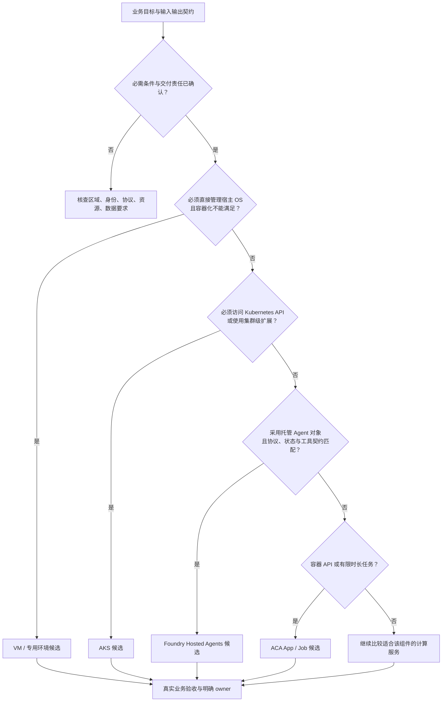

# 架构选型建议

[返回首页](../README.md) · [参考架构](reference-architecture.md) · [验证结果](validated-findings.md)

**先把业务需求转成可验证的运行契约，再选择 runtime。**本研究已经证明所选业务和框架可以在三端接入；客户决策要进一步区分所需控制范围、托管边界与交付责任。

## 1. 确定选型对象与必需条件

“使用 Foundry 模型”与“将 Agent 运行在 Foundry Hosted Agents”是两个决定。模型、工具、检索和网关可以与 Agent worker 使用不同运行服务；对每个执行组件分别选择，不把完整系统压成一个平台名字。

先完成以下需求表：

| 问题 | 需要形成的明确输入 |
|---|---|
| 是否需要 Agent？ | 普通模型调用、单 Agent 工具循环或多 Agent 协作；采用满足需求的最小复杂度 |
| 任务是什么形态？ | 在线、流式、有界批处理或长任务；接受时点、结果读回和中断处理 |
| 保存什么状态？ | 会话、业务状态、工作文件、checkpoint 与副作用的独立契约 |
| 谁能访问什么？ | 用户、workspace/业务租户、实际工作负载身份与下游资源范围 |
| 必须控制到哪一层？ | 应用流程、容器配置、Kubernetes API/节点，还是宿主 OS |
| 交付条件是什么？ | 目标区域、数据要求、协议、资源与配额、开发/运维 owner、服务目标和预算口径 |

企业内部、外部客户和个人用户是需求背景，不是服务准入规则。数据敏感、规模较大或成本目标严格，也不能单凭标签宣布某个 runtime 唯一适用。

## 2. 技术决策树

这条路径由公开计算选型、Hosted Agents 和应用架构资料整理，应用于**单个执行组件**：

VM 和其他计算服务属于候选范围说明，本研究没有为它们提供实测评分。决策树产出候选，而不是上线许可；协议、区域或资源要求不匹配时，应返回需求与候选核查，而不是强行沿树选一个服务。

### 读懂树里的三个分界

- **OS 控制与 Kubernetes 控制不是一回事。**需要 Kubernetes API 是 AKS 的明确匹配条件；需要直接管理 OS 的组件应另行评估 IaaS 等方案。
- **托管容器与托管 Agent 生命周期不是一回事。**ACA 管理底层容器承载，但应用自己定义任务和业务状态；Foundry 提供 Agent 对象与协议机制，应用仍实现业务代码与授权。
- **托管不等于无开发或无运维。**三条路径都需要明确开发、运行、故障响应和费用治理的责任人；平台替代的是部分机制，不是全部交付工作。

## 3. 按需求作出选择

| 客户需求 | 建议路径 | 决策理由 |
|---|---|---|
| 把已有容器化 Agent API 或后台任务上线，不需要 Kubernetes 专属能力 | **优先评估 ACA** | App 与 Job 分别承载在线服务和有限时长任务，可以减少自管集群的治理面 |
| 已有成熟 Kubernetes 平台，要求节点池、调度、网络策略或复杂工作负载组合 | **优先评估 AKS** | 可以沿用现有平台治理、资源调度和运维体系 |
| 产品围绕 Agent endpoint、identity、version 和 session 构建 | **优先评估 Foundry Hosted Agents** | 托管 Agent 生命周期与产品对象一致，减少自行搭建相同平台机制的需求 |
| 需要在三端保留业务迁移能力 | **统一业务契约，隔离 runtime 适配** | 本研究采用相同业务逻辑、输入和输出契约，三端只在原生调度与生命周期上适配 |
| 单个组件需要直接控制 OS，或当前容器方案无法满足其依赖 | **另行评估 VM 或专用计算服务** | Azure 提供更广的计算选择；不把三端研究误作整个服务目录的排他性结论 |

这里的“优先”是需求匹配建议，不是实验产生的综合评分。ACA 也需要容量与发布管理；AKS 的细粒度控制不自动等于更高性能；Hosted Agents 的托管能力不替代业务授权。

## 4. 优势、代价与责任差异

| 取舍 | ACA | AKS | Foundry Hosted Agents |
|---|---|---|---|
| 核心便利 | 容器 App/Job 与现有接口和有限时长任务直接对应 | Kubernetes API、调度与节点池控制可纳入已有平台治理 | endpoint、identity、version、session 与 Agent 产品对象对应 |
| 自主控制的重点 | 应用协议、工具、状态和容器资源配置 | 同时控制工作负载、集群策略、节点与调度 | 自有 Agent 代码、框架、协议选择和下游工具；托管边界内运行 |
| 需要接受的边界 | 不开放底层 Kubernetes API；不能把基础设施托管当作业务自动恢复 | 常规集群治理面较广；更多控制不自动形成性能或成本优势 | 明确平台协议和 session 行为；不能把 session 当作全部业务状态 |
| 交付责任 | 应用开发、容量规则、发布与任务治理 | 平台团队与业务团队共同管理运行和变更 | Agent 开发、工具授权、业务恢复和版本验收 |

以下责任表展开运行对象与权限设计：

| 责任 | ACA | AKS | Foundry Hosted Agents |
|---|---|---|---|
| 运行单元 | App、Job、revision | Deployment、Service、Job、Pod | Agent、immutable version、endpoint、session |
| 基础设施治理重点 | 环境、资源配置、扩缩容规则和 revision | 集群升级、节点池容量、调度与工作负载策略 | Agent 版本、协议配置、身份和托管生命周期 |
| 业务状态与副作用 | 应用定义持久状态、checkpoint 与幂等 | 应用定义持久状态、checkpoint 与幂等 | 使用所选协议的平台能力，同时定义业务状态、工具副作用与恢复契约 |
| 下游数据访问 | 应用与工作负载身份共同约束 | 应用、Kubernetes 服务账户与联合身份共同约束 | Agent identity 的资源权限与应用授权共同约束 |
| 发布验收对象 | revision 与真实业务任务 | Deployment/Job 与真实业务任务 | version/session 与真实业务任务 |

AKS 建议针对本研究采用的常规集群管理方式；不把这里的运维责任直接套用于 AKS Automatic 等其他管理模式。

Foundry 的平台 session 与业务 workspace、任务账本不是同一对象。官方文档定义了平台会话持久化与隔离能力；本研究的恢复结果主要验证应用持久状态和 checkpoint，二者应分别解释。

## 5. 工程团队应固定的契约与验收

1. **任务契约：**提交即绑定业务参数、runtime 和版本；重复请求返回原任务，不产生第二次副作用。
2. **状态契约：**区分会话历史、业务状态、工作文件和 checkpoint；明确每类数据的持久化位置与授权范围。
3. **身份契约：**浏览器用户、网关身份和工作负载身份分开；下游权限只授予实际执行身份。
4. **发布契约：**新任务进入新版本，在途任务保持原绑定；回滚后重新检查真实业务、结果和导出。

这些契约比把所有平台功能放进一张总分表更能帮助客户控制上线风险。

候选确定后，以客户自己的输入、工具和数据验证：

| 验收问题 | 本研究可参考的结果 |
|---|---|
| 原业务和所选框架是否真实执行？ | P1 与真实 T/R/S 业务 |
| 中断、重试和版本变化会不会重复副作用？ | P3 状态/checkpoint 与 P9 在途任务、回滚 |
| 是否有实际允许与拒绝，而不只是资源配置？ | P4 应用权限、P6 私网、P7 工作负载身份 |
| 故障能否关联到原任务、实例和版本？ | P8 受控工具超时 |
| 费用能否按输入、请求、资源窗口和共享层解释？ | P10 分层组件；模型估算与平台账单分别核算 |

这些实验帮助定义验收方法，不替客户补齐其真实负载、业务数据、服务目标或合规评估。按场景组织的配套与检查问题见[场景与服务组合](use-cases.md)。

## 6. 官方设计依据

- [Azure Container Apps Jobs](https://learn.microsoft.com/en-us/azure/container-apps/jobs)：在线 App 与有限时长 Job 的职责区别。
- [AKS 基线架构](https://learn.microsoft.com/en-us/azure/architecture/reference-architectures/containers/aks/baseline-aks)：网络、身份、节点、连续性与团队治理责任。
- [Foundry Hosted Agents](https://learn.microsoft.com/en-us/azure/foundry/agents/concepts/hosted-agents)：托管 Agent 的代码、协议、身份与生命周期边界。
- [Azure 计算服务选型](https://learn.microsoft.com/en-us/azure/architecture/guide/technology-choices/compute-decision-tree)：从控制与工作负载要求确定计算候选，允许一个系统组合多种服务。
- [Agent 编排模式](https://learn.microsoft.com/en-us/azure/architecture/ai-ml/guide/ai-agent-design-patterns)：按需求选择普通模型调用、单 Agent 与多 Agent。
- [Azure Virtual Machines](https://learn.microsoft.com/en-us/azure/virtual-machines/overview)：计算环境控制及客户承担的 OS/软件维护。
- [多租户应用架构](https://learn.microsoft.com/en-us/azure/architecture/guide/multitenant/overview)：应用租户、用户和身份目录的区别，以及企业/消费者服务的架构考虑。

官方资料用于解释产品设计；本报告中的实测结论以[证据摘要](../evidence/verified-findings.json)为准，不把文档中的全部产品能力写成本研究已完成的验收。
