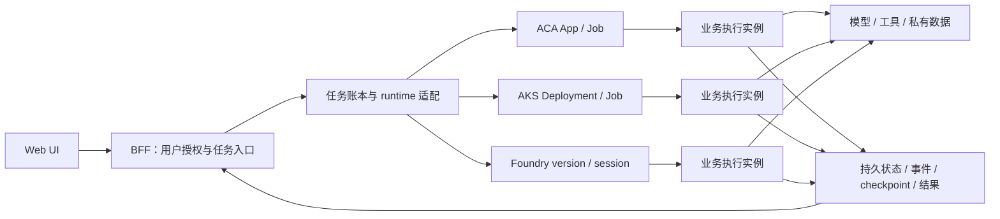

# 参考架构与责任边界

[返回首页](../README.md) · [选型建议](architecture-decision.md)

**保留同一套业务与交互契约，把运行平台差异收敛在适配层。**状态、授权、任务与结果需要贯穿全链路，而不是依附某一个容器或某一个 UI 页面。

## 1. 逻辑结构

三个业务实例表示相同逻辑分别运行在三端。网关部署在哪个平台，不决定实际业务执行位置；验收需关联原生任务、镜像或版本与业务回执。

图中账本与持久状态是逻辑职责，不要求业务、事件、会话历史全部使用同一个物理存储。本研究使用共同私有存储验证部分契约，客户应按数据特性选择实际服务。

## 2. 不应混淆的对象

| 对象 | 作用 | 设计规则 |
|---|---|---|
| 用户与业务 workspace | 界定谁能访问任务和数据 | 从可信服务端身份确定，不信任客户端自报范围 |
| 原生 session | 平台路由、会话和生命周期对象 | 不将其直接当作业务任务账本 |
| 任务记录 | 绑定参数、runtime、版本与结果 | 接受后持久化，重复提交读回原记录 |
| 业务状态与文件 | 保存工作进度和业务输入输出 | 采用明确的权限、版本与保留规则 |
| Checkpoint | 在定义的步骤恢复执行 | 与工具副作用幂等共同设计 |
| 模型使用量 | 记录实际请求和 token | 与平台账单分开解释 |

## 3. 身份与数据面

用户授权在 BFF 与业务服务中执行；实际云资源访问使用工作负载身份。模型与存储凭据不进入浏览器，固定工具子进程只接收本次所需输入。

私网接入的验收对象是实际请求：DNS 解析、TLS 主机校验、允许访问与拒绝对照。RBAC 的验收对象是实际执行身份对目标资源的数据面访问。资源创建成功和角色配置存在不能替代这两类结果。

## 4. 失败与重试

确认失败与结果未确认要分开处理。传输超时可能发生在业务已接受请求之后，因此未确认任务先按原 ID 协调读回，不自动发起第二次模型请求或工具写操作。

本研究中协调服务重启后，被中断任务保持未确认；已完成任务和持久状态可以读回。这个设计避免把“进程重启”误写成“所有业务自动恢复成功”。

## 5. 发布与运行观察

新提交绑定新版本，在途任务保持原版本。回滚不是只改路由：应重新验收 Trading/RAG 等业务结果、会话绑定、导出和用户界面。

运行记录至少关联任务、runtime、原生 job/session、镜像或版本、工具事件和安全错误码。本研究的受控超时已完成这条关联链；不把诊断探针成功理解为注入业务成功。

Foundry 平台能力、协议选择和应用责任的解释参考[官方 Hosted Agents 文档](https://learn.microsoft.com/en-us/azure/foundry/agents/concepts/hosted-agents)。本研究通过统一适配控制比较边界，并不要求所有新项目都采用同一个协议。

## 6. 系统组合与选型对象

模型调用位置、Agent 业务执行位置和用户入口是不同选择。使用 Foundry 模型，不要求将全部应用组件部署到 Hosted Agents；采用 Hosted Agents，也不要求网关和外部检索使用相同承载方式。

| 组件 | 主要选型问题 |
|---|---|
| 用户入口与 BFF | 认证、输入契约、接收任务、状态与结果访问 |
| Agent 编排代码 | 采用模型调用、工具循环还是多 Agent 协作；如何保存步骤与副作用 |
| 实际执行承载 | 是否需要 Agent 生命周期、普通容器、Kubernetes API 或 OS 控制 |
| 模型、检索与工具 | 数据与模型访问、私网、授权、延迟和独立故障边界 |
| 持久状态与运维 | 状态权限、保留、版本、关联链与分层费用 |

选择 runtime 时针对实际执行组件；选择完整方案时考虑组件组合。容器、Job 或 session 只是一部分机制，不等于已经实现完整业务运行契约。技术筛选路径见[架构选型建议](architecture-decision.md)，需求画像见[场景与服务组合](use-cases.md)。
